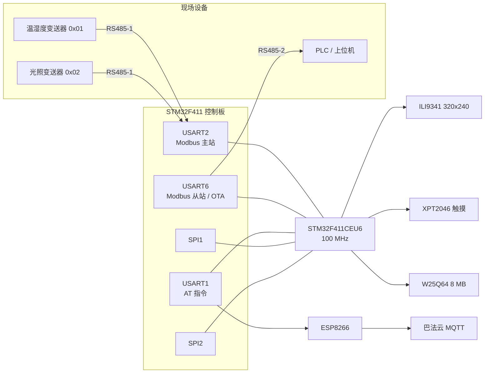

# 硬件与接线

## 系统框图

## 引脚分配

| 功能 | 引脚 | 说明 |
|---|---|---|
| USART1 TX / RX | PA9 / PA10 | ESP8266，115200 |
| USART2 TX / RX | PA2 / PA3 | RS485-1，Modbus 主站，9600 |
| USART2 方向 | PB0 | DE，高电平发送 |
| USART6 TX / RX | PA11 / PA12 | RS485-2，Modbus 从站 + OTA |
| USART6 方向 | PB8 | DE，高电平发送 |
| SPI1 SCK / MISO / MOSI | PA5 / PA6 / PA7 | 屏与触摸共用 |
| LCD CS / DC / RST | PB6 / PB7 / **PB5** | RST 已从 PA11 移走 |
| LCD 背光 | PA8 | 高电平点亮 |
| 触摸片选 | PB10 | XPT2046 |
| SPI2 SCK / MISO / MOSI | PB13 / PB14 / PB15 | W25Q64 |
| W25Q64 片选 | PB12 | |
| 状态灯 | PB3 / PB4 / PA15 | |
| SWD | PA13 / PA14 | 下载与调试 |

> **PA11 原来接 LCD_RST**，做第二路 RS485 时改到了 PB5，硬件需要改一根线。

## RS485 接线

| MAX3485 | 接到 |
|---|---|
| VCC | **3.3 V**（5 V 模块会损坏 PA12） |
| GND | GND |
| DI | MCU TX |
| RO | MCU RX |
| DE 与 /RE | 短接后接方向脚 |
| A / B | 双绞线到对端 |

- 线长小于 2 m 可以不接终端电阻，超过 10 m 两端各 120 Ω
- A/B 接反只收不到数据，不会损坏器件
- 建议 DE 对地加 10 k 下拉，避免复位期间浮空误开驱动器

## 电源

| 器件 | 电流 | 建议 |
|---|---|---|
| STM32 + 屏 | ~120 mA | 3.3 V |
| ESP8266 | 峰值 300 mA | **单独 3.3 V 供电**，并 470 uF |

> 不要用 ST-Link 的 3.3 V 给 ESP8266 供电：发射瞬间电压跌落会导致 Flash 擦写失败。

## 上电顺序（面包板推荐）

1. 电源 + SWD：确认 3.3 V 稳定，能连上目标
2. USART1 + USB-TTL：确认能打印
3. 屏 + 触摸：先刷纯色，再读坐标
4. W25Q64：读 ID 应为 `0xEF4017`
5. RS485-1：用 Modbus Slave 软件模拟从机
6. RS485-2：9600 下作为从站应答
7. ESP8266：确认能上报 MQTT
8. OTA：115200 下发送 bin

## 常见问题

| 现象 | 排查 |
|---|---|
| 屏幕花屏 | 检查 `LV_COLOR_16_SWAP`、RST/CS/DC 接线 |
| 触摸方向反 | 调整 `TOUCH_SWAP_XY` 与 `TOUCH_MIRROR_X/Y` |
| W25Q64 读 ID 为 0xFFFFFF | SPI2 未通，检查 PB12~PB15 |
| Modbus 收不到 | A/B 反接、PB0 方向脚、波特率 |
| 第二路 RS485 不回 | 检查 PA11/PA12、PB8、3.3 V 供电 |
