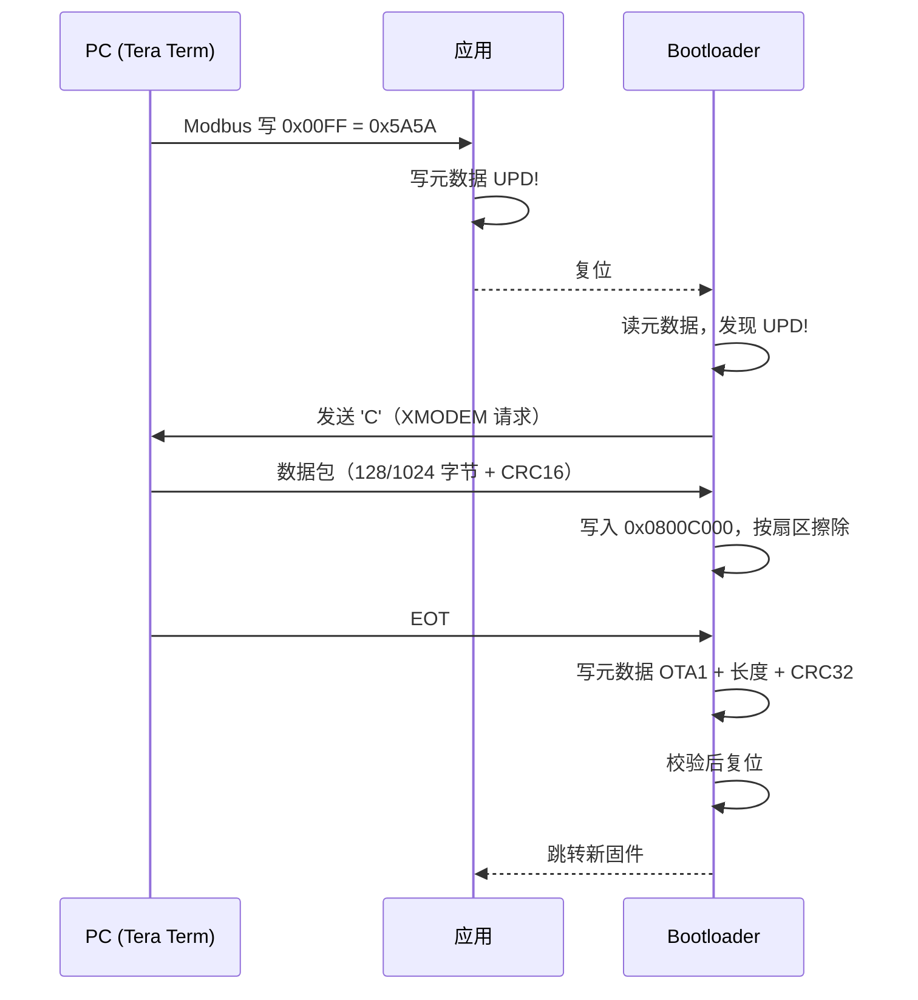

# OTA 升级

## 分区

| 地址 | 大小 | 用途 |
|---|---|---|
| `0x08000000` | 32 KB | Bootloader |
| `0x08008000` | 16 KB | 元数据（升级标记 / 镜像信息） |
| `0x0800C000` | 464 KB | 应用程序 |

元数据有三种状态：

| 状态 | 含义 | 上电行为 |
|---|---|---|
| `UPD!` | 已请求升级 | 进入下载模式 |
| `OTA1` + CRC 正确 | 镜像有效 | 跳转应用 |
| 空（0xFFFFFFFF） | 出厂镜像 | 应用有效则跳转，否则下载 |

## 升级流程



## 操作步骤

1. 串口助手连 **RS485-2**，9600 8N1，发送触发帧：

   ```
   0A 06 00 FF 5A 5A 02 1A
   ```

2. 板子复位进入 Bootloader，把串口改为 **115200**，会持续收到字符 `C`

3. 生成 bin（Keil 中配置）：

   ```
   fromelf --bin --output "$L@L.bin" "#L"
   ```

4. Tera Term → File → Transfer → XMODEM → Send，选择 `.bin`

5. 传输完成后自动复位运行新固件

## 失败处理

| 情况 | 结果 |
|---|---|
| 传输中断 / 断电 | 元数据保持 `UPD!`，重新上电继续等待下载 |
| 校验失败 | 不会写元数据，仍停在下载模式 |
| 元数据写入中断 | 下次上电判定无效，重新下载 |

**Bootloader 本身不会被 OTA 改写**，所以最坏情况也只是重新发一次固件。

## 限制

- 单应用分区，**不支持回滚**
- 升级期间 RS485-2 不能同时做 Modbus 从站
- Bootloader 只能通过 SWD 烧录
